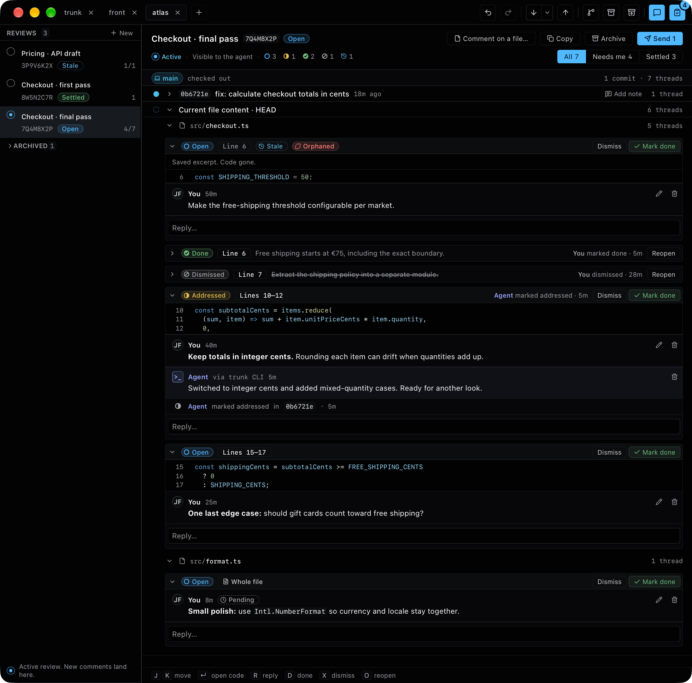

# Trunk

A fast, native desktop Git GUI. Open any repository, read its history as a commit graph, stage work, and commit without touching the terminal.


## Why

Most Git GUIs feel heavy or hide what Git is doing. Trunk renders the full commit graph with virtual scrolling, so a 50k-commit history scrolls as smoothly as a tiny one. The graph topology gets computed in Rust through libgit2, not pieced together from CLI output.

## Features

- **Commit graph** with branch, tag, and stash labels and distinct merge dots
- **Staging** files or everything, then commit with a message and body
- **Diffs** for any commit, staged change, or working-tree change
- **Branches** checkout, create, merge, and rebase
- **Merge editor** compare both sides of a conflict, edit the result, and stage it
- **Remotes** pull, push, and fetch
- **Stashes** create and pop
- **Interactive rebase** with a reorder-and-edit editor
- **Code review** with inline comments anchored to diff lines
- **Live updates** from a filesystem watcher that refreshes status when files change on disk

## Code review

Review changes with comments on diff lines, current file content, or whole files. The review pane keeps feedback and replies together, with filters for threads that need your attention.

Send feedback to a coding agent as you go or in a batch. Agents can reply and mark fixes addressed through the [`trunk review` CLI](docs/review-cli.md); you decide when a thread is done.



## Recover a merge edit on macOS

When **Save and Mark Resolved** replaces a working file, Trunk keeps the original in that worktree's Git directory. If another editor still has the original open and writes through that handle, its edits land in the retained file. Once Save succeeds, the working file contains your resolution and Git has staged it.

From the affected worktree, run this command to open the recovery folder in Finder.

```sh
open "$(git rev-parse --absolute-git-dir)/trunk-merge-recovery-$(id -u)"
```

Each save has its own folder. The `path` file names the repository-relative path. After a successful Save, `original` contains the displaced file. Finish saving in the other editor and close the file there. Copy `original` to a separate location, compare it with the resolved file, and stage any edits you want to keep.

If Trunk quit during Save, compare the working file and `original` first. Either can hold the proposed resolution with mode `000`. Its owner can grant themselves read access to that file before comparing. If Git reports an index lock, `git rev-parse --git-path index.lock` gives its location. Close Trunk and check that no Git operation is using this worktree. Remove the lock only after confirming it is stale, then stage the resolution.

Each macOS account has its own recovery folder. Recovery files stay in the worktree's Git directory until you remove them. To reclaim space, move the individual save folders you have finished with to the Trash, then delete those items from the Trash. If another program also replaced the working file, use the `path` files to find the saves for that file. A file named `withdrawn` holds the version removed while restoring the working path.

If the working file and its Git directory are on different volumes, Trunk cannot move the original into recovery. Use **Copy draft** to copy Output with its line endings. Save it in your editor, then use the **+** (Stage file) beside that file in Trunk.

In a shared checkout, macOS can refuse to give a replacement file the original owner or group. If Trunk reports that it cannot preserve ownership, have the owner perform the save or staging step.

## Stack

Tauri 2 shell, Svelte 5 frontend (runes, Tailwind CSS 4), Rust backend. Trunk uses libgit2 for repository access and invokes Git for operations that depend on the user's configuration, including clean filters when staging a merge resolution.

## Develop

```bash
just          # list every recipe
just dev      # run Vite + Tauri in watch mode
just build    # production build
just check    # fmt, biome, svelte-check, clippy, cargo test, vitest
```

Run `just check` before you commit.

Architecture notes, decision records, and known issues live in [`docs/`](docs/README.md).

## License

Apache-2.0. See [LICENSE](LICENSE) and [NOTICE](NOTICE).
